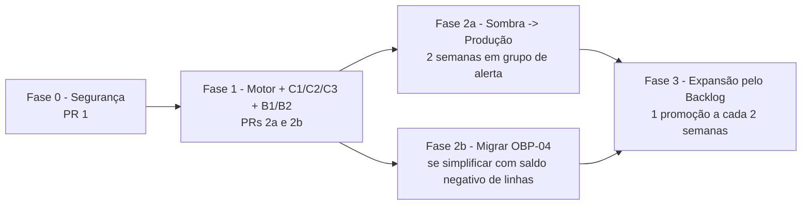

# Roadmap Estratégico — Hub de Automações (2026–2027)

> Aprovado em 21/11/2026. Fonte de verdade para prioridade de produto, arquitetura de novas automações e dívida técnica programada.

---

## 1. Diagnóstico (baseline em 21/11/2026)

| Eixo | Evidência medida |
|---|---|
| **Confiabilidade da plataforma** | Últimos 30 dias em `Orchestrator/automacoes.db`: **647 `SUCCESS`, 2 `ERROR`, 2 `REQUEUED`, 1 `TIMEOUT`** (~99% de sucesso). |
| **Foco recente** | ~13 dos últimos 15 PRs foram de infraestrutura (fila SMB Oracle, bridge removido, migração PS→Python, pre-commit). |
| **Aproveitamento do acervo SQL** | `docs/oracle-schema/consultas/` possui **238 arquivos** (**224 validados** no Oracle), mas apenas ~7 alimentam produtos ativos (6 automações + Beneficiamento). |
| **Custo por nova automação** | Cada entrega sob medida (`OBP-04`, `OFST-06`, `ORB-07`) exige runner, card, state, runbook e testes próprios — gerando até testes de paridade (`test_ofst_orb_parity_unit.py`) para conter drift. |
| **Dívida de segurança acumulada** | 5 issues semanais abertas de `pip-audit` (`pillow 12.3.0` e `certifi 2026.7.22`) + `issue #8` (`get_client_ip` / `X-Forwarded-For`). |

**Diagnóstico central:** a plataforma já entrega confiabilidade. O gargalo passou a ser **velocidade e custo marginal para transformar consultas validadas do catálogo em valor operacional** para as áreas de negócio.

---

## 2. Decisões Estratégicas Fechadas

1. **Eixo principal (6 meses):** crescimento de valor de negócio (~80% do esforço), reservando ~20% para dívida crítica de segurança.
2. **Área prioritária:** **PCP / Beneficiamento**, complementada por sentinelas de alto retorno em **Químicos** e **Qualidade na Montagem**.
3. **Modelo de entrega (híbrido):**
   - **WhatsApp** apenas por **exceção** (quando há item crítico/novo fora do padrão), evitando fadiga de alerta nos grupos.
   - **Dashboard (`/pcp`)** com visão contínua **snapshot-first** (leitura local de JSON/SQLite, sem consulta Oracle em tempo real).
4. **Arquitetura — Modelo 2 (Motor declarativo + `Consultas Promovidas/<slug>/`):**
   - Um motor compartilhado (`lib/python/promovidas/`) executa consultas promovidas a partir de configuração declarativa (`promocao.json`) sobre `hub_runner.py` e `oracle_queue.py`.
   - Cada promoção vive em `Consultas Promovidas/<slug>/` com `promocao.json`, `consulta.sql` (movida do acervo via `git mv`, nunca copiada), `automation.manifest.json` (`queue_group="oracle"`) e shim `run.ps1`.
   - `portfolio_manifest.py` e `Tools/Test-AutomationCatalog.ps1` passam a descobrir manifestos também em `Consultas Promovidas/*/` e aceitar o canal `"dashboard"`.
   - **Por quê Modelo 2:** mantém a raiz do repositório limpa com 10+ promoções, preservando o Orchestrator como dono de cron, pause/resume, requeue, SLA, logs isolados e lock de `queue_group="oracle"`.
5. **Validação em modo sombra:** novas automações de alerta rodam primeiro com `"modo": "sombra"` por 2 semanas enviando apenas para o grupo de alerta já ativo (`AUTOMACAO_ALERT_WHATSAPP`), com validação dos limiares pelo dono antes de liberar para grupos produtivos.

---

## 3. Escopo Inicial Aprovado (Piloto + Bônus Priorizados)

| Código | Controle | Consulta do Acervo (`tempo Oracle`) | Dor resolvida | Canal alvo |
|---|---|---|---|---|
| **C1** | **Risco de atraso de pedidos nas Ramas** | `02_acabamento_preparacao/acb_rama_fila_risco_expedicao_pedidos.sql` (`55 ms`) | Conecta OBs pendentes nas ramas à data `EXPEDIREM` e ao cliente. | Exceção WhatsApp + Painel |
| **C2** | **Pulmão (Buffer) e Autonomia das Ramas** | `02_acabamento_preparacao/acb_rama_pulmao_buffer_vs_pipeline.sql` (`94 ms`) | Mede horas de autonomia por rama (pronto vs em trânsito) para evitar parada seca. | Painel + Exceção por autonomia mínima |
| **C3** | **Gargalo completo de receitas no Tingimento** | `01_beneficiamento_tingimento/bnf_gargalo_receitas_obs_aguardando.sql` (`562 ms`) | Cobre OBs sem receita ativa, bloqueada ou não emitida (fecha ponto cego entre `RB-01` e `RE-03`). | Exceção WhatsApp + Painel |
| **B1** | **Sentinela de ruptura de compra de Químicos** | `09_pcp_kpis_gestao/pcp_sentinela_quimicos_ruptura_compra.sql` (`4,4 s`) | Antecipa ruptura de corantes/auxiliares evitando parada ou compra emergencial. | Exceção WhatsApp + Painel |
| **B2** | **Qualidade na Montagem (pré-tingimento)** | `06_qualidade_auditoria_obs/qld_obs_montadas_fora_da_regra_de_separacao.sql` (`211 ms`) + `06_qualidade_auditoria_obs/qld_conferencia_ob_montada_conferir_se_usaram_as_pecas_com_restricao.sql` (`117 ms`) | Intercepta erro de montagem e uso de peça com restrição antes do tingimento. | Exceção WhatsApp + Painel |

---

## 4. Plano em Fases

| Fase | Escopo | Critério de saída |
|---|---|---|
| **Fase 0 — Segurança** | Zerar `pip-audit` (`Pillow>=13.0`, `certifi>=2026.10.18`), deduplicar issues em `seguranca-agendada.yml`, corrigir `get_client_ip` (`issue #8`), comparar cards PNG antes/depois do Pillow 13. | `pip-audit` limpo; issues #8, #73, #79, #81, #83, #90 fechadas; cards PNG sem regressão visual. |
| **Fase 1 — Motor + Piloto** | PR 1a: motor `lib/python/promovidas/`, Modelo 2 no scanner/validador, scaffold `-Runtime promovida`, API `/api/promovidas/*`, **ADR-021** em `CONTEXT.md`, promoções **C1, C2, C3, B1, B2** em modo sombra. PR 1b: página `/pcp` no Dashboard + Playwright E2E. | Gates + preflight + Playwright E2E verdes; `-DryRun` real via fila Oracle; zero regressão nas 6 automações existentes. |
| **Fase 2a — Validação em sombra** | 2 semanas de envio em `AUTOMACAO_ALERT_WHATSAPP`; ajuste fino de limiares com o dono; promoção para `"modo": "producao"` nos grupos de negócio. | Limiares aprovados e documentados nos runbooks e em `automation-criticality-map.md`. |
| **Fase 2b — Prova de generalidade (`OBP-04`)** | Avaliar migração do `OBP-04` para o motor declarativo com paridade de saída. **Regra de corte:** se o card por fase não couber no motor sem distorcer sua simplicidade, manter `OBP-04` isolado e registrar a exceção no ADR-021. | **Concluída (22/11/2026):** exceção registrada no ADR-021 — `OBP-04` permanece standalone por roteamento multi-destino por fase, estado duplo (`obs_seen_state.json` + `delivery_state.json`) e card customizado (`FaseConfig`). |
| **Fase 3 — Expansão contínua** | Promover itens do backlog abaixo sem escrever código de runner/card novo. | < 1 dia e zero código Python de orquestração por nova consulta promovida. |

### Indicadores de sucesso (6 meses)
- **Custo marginal de promoção:** < 1 dia e 0 código novo de runner/card a partir da 3ª promoção.
- **Promoções ativas:** >= 8 entregas ativas ao fim do mês 6.
- **Confiabilidade:** taxa de sucesso >= 98% mantida no Orchestrator.
- **Segurança:** 0 issues de `pip-audit` abertas há mais de 7 dias.

---

## 5. Backlog Priorizado para a Fase 3

| Prio | Área | Candidata | Consulta(s) do Acervo | Destino | Pré-requisito / Observação |
|---|---|---|---|---|---|
| 1 | PCP | Aging de OBs vs SLA por fase | `pcp_aging_obs_por_fase_vs_sla.sql` | Painel | Calibrar `SLA_DIAS` por fase com a área (hoje `3` é premissa). |
| 2 | PCP | Fila programada por máquina de tingimento | `bnf_fila_programada_por_maquina_tingimento.sql` | Painel | Complementa o Beneficiamento olhando UPs futuras e `QT_ATRASADAS`. |
| 3 | PCP | Sincronismo Malha × Ribana (Lojas) | `pcp_sincronismo_malha_ribana.sql` | Painel + Exceção | Evita travar expedição esperando ribana. |
| 4 | PCP / Fechamento | Fechamento do mês + meta diária Rama/Felpadeira | `bnf_fechamento_mes_obs_em_aberto_com_origens.sql`, `acb_monitora_rama_quanto_precisa_fazer_para_fechar_o_mes.sql` | Painel mensal | Resumo automático na última semana do mês. |
| 5 | Químicos / Custos | Fechamento quinzenal e mensal automático | `pcp_fechamento_quinzena_quimicos_cavaco_producao.sql`, `pcp_fechamento_mensal_quimicos_cavaco_producao.sql` | E-mail (dias 16 e 1) | Requer suporte a bind (`:mes_ref`) no motor. |
| 6 | Comercial | Pedidos atrasados + saldo acabado não faturado | `com_consulta_pedidos_atrasados.sql`, `com_saldo_kgs_acabados_pendentes_faturamento.sql` | Painel + Exceção | Alinhar janela com Comercial/Expedição. |
| 7 | Comercial | Sentinela de preço R$ 0,01 | `com_precos_carteira_pedidos_abertos.sql` | Exceção | Hoje retorna 0 linhas; ruído zero. |
| 8 | Qualidade | Pesos iguais / divergência > 20% | `qld_ob_s_com_pesos_iguais_nas_pecas.sql`, `qld_ob_s_com_peso_20_maior_ou_menor_comparado_a_peca_crua.sql` | Exceção diária | Auditoria de balança e quebra de peso. |
| 9 | Malharia | Paradas longas + necessidade crítica | `mal_paradas_longas_eventos.sql`, `mal_necessidade_critica_somente_faltas.sql` | Exceção + Painel | Consolidar sem duplicar visão existente. |
| 10 | Facção | Saldo de NF e programação ambígua | `fac_saldo_nf_faccao.sql`, `fac_diagnostico_programacao_ambigua.sql` | Painel + Exceção | Complementa o `MT-02`. |
| 11 | Manutenção | Backlog de OMs e MTTR | `kpi_manutencao_backlog_om_aberta.sql`, `kpi_manutencao_mttr_mensal.sql` | Painel | Observar ressalva da Fiação em `KPI_CATALOGO.md`. |
| 12 | Gestão | Resumo executivo semanal | Snapshots já promovidos | E-mail (seg 07:00) | Sem nova consulta Oracle; lê snapshots locais. |

> [!NOTE]
> `kpi_paradas_uniao_fontes_mensal.sql` (16,8 s no Oracle) não entra em automação sem reescrita prévia, pois fica no limite do orçamento de 20 s e acima da janela estável de sessão direta (~4–6 s).

---

## 6. Riscos Abertos e Fora do Escopo Atual

1. **Risco Aberto nº 1 (Continuidade de Dados):** `Orchestrator/automacoes.db` e `Produção Beneficimento/snapshots/beneficiamento_historico.db` não possuem backup automatizado versionado ou externo. Em perda da máquina de produção, a série histórica do Beneficiamento não é reconstruível (`docs/runbooks/recuperacao-de-maquina.md`).
2. **Backlog Técnico Adiado (fora dos ~20% iniciais):**
   - Execução da `docs/oracle-schema/consultas/PROPOSTA_CONSOLIDACAO.md` e destino versionado para `backup_legado_sql.zip` (hoje ignorado pelo `.gitignore`).
   - Issue #15 (`oracledb` travado em `3.3.0` por compatibilidade com Oracle 12.2 / verificador legado).
   - Otimizações incrementais adicionais no tempo de pre-commit e gates redundantes.
